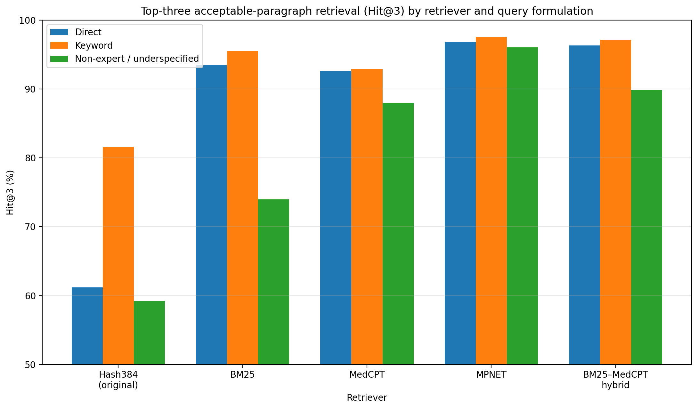

# Query-Formulation Sensitivity in Citizen-Facing Public-Health RAG

**Research Portfolio | LLM Evaluation | Retrieval-Augmented Generation (RAG) | Information Retrieval | Scientific Computing | Statistical Analysis**

## Research Team

**Malihe Aliasgari** — Kean University  
**Yousef Nejatbakhsh** — Rutgers University  
**Parsa Safaee** — Eindhoven University of Technology  

**Manuscript:** *Query-Formulation Sensitivity in Citizen-Facing Public-Health RAG: A Five-Retriever Retrieval Comparison and a Single-Configuration End-to-End Study*  
**Journal:** *Discover Artificial Intelligence*  
**Status:** Under Review

---

## Project Overview

This project evaluates the reliability of a **citizen-facing public-health retrieval-augmented generation (RAG) system** under two practical sources of variation:

1. **How people ask questions** — direct questions, keyword queries, and non-expert / underspecified formulations.
2. **How the source corpus is affected by noise** — including OCR corruption, word deletion, and distractor contamination.

The study was designed to examine how these factors influence **retrieval success, answer accuracy, faithfulness to retrieved evidence, and abstention behavior** in a public-health question-answering pipeline.

This work is especially relevant to the safe evaluation of LLM-based systems because it emphasizes **grounding, selective answering, error analysis, and reproducibility**, rather than raw fluency alone.

---

## Experimental Design

The study used a controlled repeated-measures design with:

- **108 underlying public-health questions**
- **9 health topics**
- **3 query formulations per question**
- **10 corpus conditions** (1 clean + 9 degraded)
- **3,240 end-to-end generations**
- **1,080 double-rated responses**
- **16,200 retrieval observations** across five retriever configurations

### Query formulations

- **P1 — Direct:** well-formed natural-language questions
- **P2 — Keyword:** concise keyword-style queries
- **P3 — Non-expert / underspecified:** a composite formulation varying vocabulary, specificity, framing, and question type

### Corpus conditions

The clean corpus was compared with nine degraded versions from three families:

- **OCR substitution:** O1, O3, O5
- **Word deletion:** W5, W10, W15
- **Distractor contamination:** D5, D20, D35

---

## Retrieval Configurations

The study compared five retrieval configurations:

1. **Hash384 (original deterministic hash retriever)**
2. **BM25**
3. **MPNET** (`multi-qa-mpnet-base-dot-v1`)
4. **MedCPT**
5. **BM25–MedCPT hybrid**

Important scope note:

- The **five-retriever comparison is retrieval-only**.
- **Answer generation and human evaluation were performed only under the original hash retriever**.

This distinction is important and should be preserved when presenting the project.

---

## Example Result

The figure below summarizes top-three acceptable-paragraph retrieval (**Hit@3**) across the five retrievers and three query formulations.

*Figure 1. Top-three acceptable-paragraph retrieval (Hit@3) by retriever and query formulation, recreated from the manuscript’s Table 1. This comparison is retrieval-only; answer generation and human-rating results were conducted under the original hash retriever only.*

### Summary of the retrieval result

- Under the **original hash retriever**, keyword queries showed a large observed advantage over direct questions.
- Under **BM25**, the keyword advantage was much smaller.
- Under **MPNET**, the observed overall Hit@3 was the highest, and formulation differences were minimal.
- Under several retrievers, **non-expert / underspecified queries** performed worse than direct queries.

This shows that the observed effect of query wording depends strongly on the retrieval configuration.

---

## Main Findings

### 1) Query formulation matters
Under the original hash retriever, keyword queries retrieved acceptable evidence more often than direct or non-expert / underspecified queries.

### 2) Retriever choice matters
The large keyword advantage was not universal. It was strongest for the original lexical-style hash retriever and much smaller for BM25, MedCPT, MPNET, and the hybrid system.

### 3) End-to-end evaluation requires more than one metric
The study reports not only answer accuracy, but also:

- retrieval success
- abstention
- selective accuracy
- selective risk
- appropriate abstention
- unnecessary abstention
- joint retrieval–answer states

This provides a more informative picture of system behavior than a single accuracy percentage.

### 4) Paragraph-level retrieval scoring can hide evidence damage
Under the pre-specified paragraph-level criterion, no degradation effect survived adjustment. However, an exploratory content-retention analysis showed that OCR corruption damaged usable evidence more than paragraph-level scoring revealed.

### 5) No degradation-robustness claim is made
The study explicitly does **not** claim that the pipeline is robust to corpus degradation.

---

## Technical Competencies Demonstrated

This project showcases the following technical and research skills:

- **Retrieval-augmented generation (RAG) evaluation**
- **LLM benchmarking and error analysis**
- **Information retrieval and retriever comparison**
- **Public-health QA evaluation**
- **Mixed-effects modeling and statistical inference**
- **Human evaluation workflow design**
- **Inter-rater reliability analysis**
- **Reproducible experimental design**
- **Corpus perturbation and robustness testing**
- **Python-based scientific computing and data analysis**

---

## Research Contributions

This repository represents a research portfolio summary of work that:

- evaluates **query-formulation sensitivity** in a public-health RAG setting,
- compares **five retrieval configurations** under a common benchmark,
- studies **answer accuracy, faithfulness, and abstention** under a fixed end-to-end setup,
- and highlights why **retrieval provenance alone may overstate retained evidence quality**.

---

## Limitations

This project should be interpreted carefully.

- The manuscript is **under review** and not yet accepted.
- The five-retriever comparison is **retrieval-only**.
- End-to-end answer generation and human evaluation were conducted under **one retriever only**.
- The study evaluates **informational reliability**, not **clinical safety**.
- No physician, nurse, pharmacist, or other licensed health professional participated in the evaluation.
- The benchmark and corpus are research artifacts, not a deployed medical system.
- Nothing in this work supports public deployment of the evaluated system.

---

## Repository Scope

This GitHub repository is intended as a **public-facing research portfolio summary**.

### Included or planned for public release in this repository

- project overview
- methodological summary
- recreated summary figures
- high-level technical documentation
- small independent demonstrations, if prepared separately from the research pipeline

### Not included at this stage

- full manuscript PDF
- full benchmark package
- original source corpus
- raw generations
- adjudicated evaluation records
- complete research code
- full replication package

A version-controlled public research release may be provided **after manuscript acceptance**, subject to coauthor agreement and any redistribution restrictions affecting source materials.

---

## Contact

**Malihe Aliasgari, Ph.D.**  
Research website: https://malihealiasgari20.github.io/  
GitHub: https://github.com/malihealiasgari20/

